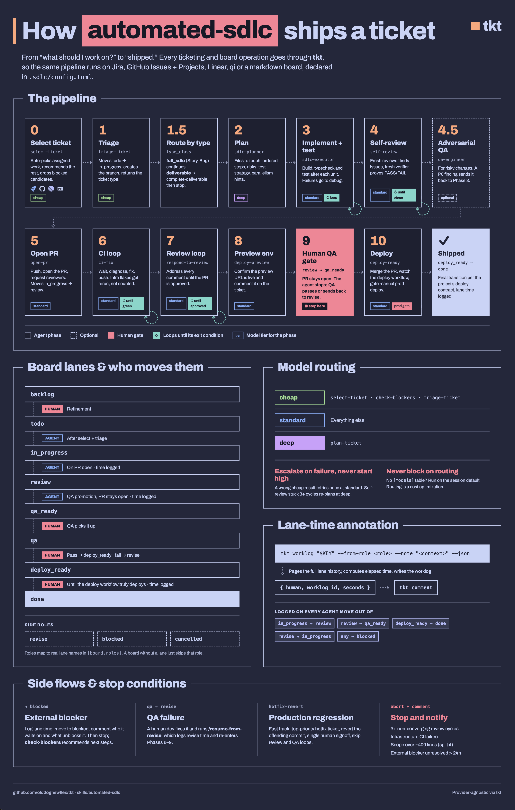

# tkt — provider-agnostic ticketing CLI

`tkt` is the adapter shim that lets the SDLC skill pack run against any ticketing
backend. Skills call **semantic verbs** (`tkt view`, `tkt transition`, ...); `tkt`
reads `.sdlc/config.toml`, dispatches to the configured provider adapter, and
normalizes every backend into one JSON shape. Skills never touch `acli`/`gh`/REST.

This is a **standalone, portable package** — clone it once and point any project at
it. Nothing here is specific to a single repo or backend. Requires Python 3.11+
(uses stdlib `tomllib`); no third-party deps. The CLI runs on macOS, Linux, and
Windows; the test suite (`tests/`) is POSIX-only.

Status: core + `jira`, `markdown`, `github`, `linear`, and `openkanban` adapters,
plus the **full** ported SDLC skill pack — 14 skills + the ticket-researcher agent
(see "Skill pack"). Adding another backend is just a new `adapters/*.py`
implementing the verb contract; no skill changes.

## The centrepiece: `automated-sdlc`

[`automated-sdlc`](skills/automated-sdlc/SKILL.md) is the skill the rest of this
repo exists to serve. It runs the whole pipeline, from "what should I work on?" to
"shipped": select, triage, route by type, plan, implement, self-review, open PR,
CI loop, review loop, preview, a human QA gate, then deploy. It does this by
orchestrating the other pack skills, with explicit human gates and lane-time
annotation. Every ticketing and board call goes through `tkt`, so the same
pipeline runs unchanged on Jira, GitHub, Linear, openkanban, or a markdown board.



Run it unattended with [`tkt run`](#unattended-runs) and watch it with
[`tkt agents`](#watching-runs--tkt-agents).

## Install

### macOS / Linux

```sh
git clone <this-repo> ~/Development/tkt
ln -s ~/Development/tkt/tkt /usr/local/bin/tkt   # put `tkt` on PATH (optional)
```

`tkt` runs from anywhere; it locates its own `core/`/`adapters/` relative to the
script, so the symlink target must resolve back to the repo (a symlink is fine).

### Windows

```powershell
git clone <this-repo> C:\tools\tkt
```

Then put `tkt` on `PATH`. Either add `C:\tools\tkt` to `Path` (Settings → System →
About → Advanced system settings → Environment Variables), or persist it from
PowerShell:

```powershell
[Environment]::SetEnvironmentVariable("Path",
  "$([Environment]::GetEnvironmentVariable('Path','User'));C:\tools\tkt",
  "User")
```

The `tkt` entrypoint is a shebang script, which Windows shells don't honour, so
invoke it through Python. A batch wrapper in a directory already on `PATH`:

```bat
@echo off
python C:\tools\tkt\tkt %*
```

…or a PowerShell function in your `$PROFILE`:

```powershell
function tkt { python C:\tools\tkt\tkt @args }
```

> Windows symlinks (`mklink`, `New-Item -Type SymbolicLink`) need Developer Mode
> or an elevated prompt. The PATH/wrapper approach avoids that entirely.

## Use in a project

Fastest path — scaffold with `tkt init`:

```sh
cd my-project
tkt init --provider markdown --link-skills --sample
#   writes .sdlc/config.toml, symlinks skills/ + agents/ into .claude/,
#   and (markdown) drops a starter ticket. --provider: jira|markdown|github|linear.
$EDITOR .sdlc/config.toml         # adjust roles/queries/repo to taste
tkt doctor                        # validate auth + board model
```

`tkt init` flags: `--provider` (required non-interactively; prompts on a TTY),
`--dir` (target, default cwd), `--force` (overwrite existing config; a symlinked
config is replaced by a regular file), `--link-skills` (symlink the pack into
`.claude/`), `--sample` (markdown starter ticket), `--no-detect-build` (skip
toolchain detection), `--project KEY` (markdown/jira: `[ticketing].project`;
linear: `[linear].team_key`; openkanban: `[openkanban].project`, a name or id;
rejected for github, which is identified by `[github].repo`), `--board-dir PATH`
(markdown board dir, written as given; the state dir becomes its sibling
`state`), `--no-inherit` (ignore a parent's shared board). It refuses to clobber
an existing `.sdlc/config.toml` without `--force`.

**Shared boards.** For `--provider markdown`, `init` looks for the nearest
`.sdlc/config.toml` in a *parent* directory (not `$TKT_CONFIG`). If that config
is a markdown board, the new repo joins it: the parent's tables are copied
(roles, issue types, queries, `me`) with this repo's own `[ticketing].project`,
`[vcs]` and `[build]`, and any `[deploy]` dropped. The parent's leading comment
block is replaced by a generated header and the comment on its `project` line is
dropped. Absolute board/state paths are copied verbatim (comments included);
relative ones, and a relative `[run].state_dir`, are rebased so they still point
at the parent's. On a TTY it asks first (`Join shared board …? [Y/n]`);
otherwise it joins and says so. `--board-dir` keeps the parent's board model but
points at another board; `--no-inherit` starts from the example instead. A
parent that isn't markdown, or isn't valid TOML, is ignored (the latter with a
warning).

The project key defaults to one derived from the directory name, split into
words on punctuation and camelCase (`tkt` → `TKT`, `ai-map-reference-platform` →
`AMRP`, `OldDogNewFlex.com` → `ODNFC`: longer than 10 characters and several
words gives initials); a TTY prompts with that default. A key must start with a
letter and hold only letters, digits and `_`. A board is *shared* when it
resolves outside the repo. When the board is shared and already holds
`<KEY>-N.md` tickets, `init` warns that another repo may own the key (it still
writes the config). `--sample` writes `<KEY>-1.md` on a private board and is
skipped on a shared one. `tkt doctor` adds an always-ok `config placeholders`
row while the config still carries the example's project key (wherever the
provider keeps it, as for `--project`) or a placeholder `[vcs].repo`.

`init` seeds `[build]` from whatever the project already declares, so skills run
the project's real commands without hand-editing: `package.json` scripts (runner
picked from `packageManager`/lockfile — pnpm, yarn, bun, npm), `Cargo.toml`,
`go.mod`, `pyproject.toml` (pytest/mypy/pyright/ruff/flake8, prefixed with
`uv run`/`poetry run` when a lockfile says so), or `Makefile` targets. A
Makefile also fills whatever the language probe leaves out (a Go repo with a
`lint:` target gets `lint = "make lint"`). Keys the project doesn't declare
keep the example's value.

Manual equivalent, if you prefer:

```sh
mkdir -p .sdlc && cp ~/Development/tkt/examples/config.markdown.toml .sdlc/config.toml
ln -s ~/Development/tkt/skills/* .claude/skills/
```

On Windows, use `tkt sync-pack` instead of the symlink step — `--link-skills` and
`ln -s` both need Developer Mode or an elevated prompt, whereas `sync-pack` writes
committed copies and needs no special permissions (it is also the better choice for
shared and CI environments on any platform):

```powershell
mkdir .sdlc -Force
copy C:\tools\tkt\examples\config.markdown.toml .sdlc\config.toml
tkt sync-pack
```

Config discovery order: `--config <path>` → `$TKT_CONFIG` → nearest `.sdlc/config.toml`
walking up from cwd. So `tkt` invoked anywhere inside `my-project` finds its config.

## Use across an organization

For shared repos and CI, install the pack as **committed copies** with
`tkt sync-pack` instead of symlinks — see [docs/install.md](docs/install.md) for
the full guide.

- `tkt sync-pack` writes real, tracked files into the repo: the always-on
  base layer (`.agents/skills`, `.agents/workflows`, `.sdlc/enforcement`, and
  `docs/sdlc` once the pack has `standards/`), the default harnesses
  (`.claude/skills`, `.github/prompts`, `.kiro/skills`, ...), an `AGENTS.md`
  managed block, and a `.sdlc/pack-manifest.json`. The `.agents/skills` and
  `.kiro/skills` mirrors are derived from `skills/` at sync time. Cloud
  harnesses, CI, and teammates only see tracked files, so this is the option
  that works off your machine.
- Adding a harness to a project that is already set up: name it —
  `tkt sync-pack cursor`. The choice is additive and sticky (recorded in the
  manifest), so later bare `tkt sync-pack` runs keep it in sync. `--all-harnesses`
  takes the whole long tail (Gemini, Cursor, Windsurf, Cline, Continue, Augment,
  OpenCode, AGENTS.md-native); `--list-harnesses` shows the names, their target
  dirs, and which ones the project already installs.
- Your own skills: write them once under `.claude/skills/<name>/SKILL.md`.
  Each sync copies them verbatim into `.agents/skills` and every other
  verbatim skill surface the repo installs (`.kiro/skills`, `.cursor/skills`),
  never into translated ones like `.github/prompts`. Names the pack ships
  are skipped, gitignored files stay put, a copy you wrote by hand is never
  overwritten, and `--prune` removes the copies of a skill you delete.
- `tkt init --link-skills` symlinks the pack into `.claude/` — fine for solo local
  work, invisible to git/CI. Use committed copies for anything shared.
- Updating: `git pull` the pack clone, re-run `tkt sync-pack` per consumer repo;
  `tkt sync-pack --check` reports drift. Re-runs are idempotent, and locally
  modified pack files are overwritten with a warning — customize upstream in the
  pack, not in consumers. A differing file at a pack path that the pack never
  wrote is copied to `<name>.pre-sdlc.bak` first (path printed; never
  tracked or pruned). Executable bits are carried and a lost one is repaired
  (only ever added, never stripped); see `docs/install.md`.
- Removing: files the selection no longer ships (a dropped harness, a retired
  skill) are kept and recorded until you run `tkt sync-pack --prune`, which
  deletes only unmodified files the previous sync recorded inside the pack's
  own dirs, never the base layer, `AGENTS.md`, the manifest, anything under
  `.git`, a path through a symlinked dir, or an alias of a file still shipped.
  `--check --prune` previews it.

## Verb contract

Every adapter implements these. Read verbs accept `--json` (either side of the verb).
`tkt --version` (or `-V`) prints the release number from `core/__init__.py`, plus the
checkout's commit when tkt runs from its own git checkout, e.g. `tkt X.Y.Z (v1.2.0-3-gabc1234)`.
A company copy also shows the upstream commit from its `PACK_VERSION` stamp.

| Command | Does | Output |
| --- | --- | --- |
| `tkt whoami` | current user id | string |
| `tkt list --tier N` / `--query NAME` `[--all-projects]` | run named query from `[queries]`; `--all-projects` drops project scoping (shared-board view) | ticket list / `--json` array |
| `tkt view KEY` | one ticket | normalized ticket / `--json` |
| `tkt activity --query NAME --since ISO [--until ISO]` | comments + field changes on the query's tickets in `[since, until)`. ISO date or datetime; no offset = UTC; `--until` defaults to now. Events sorted by time, then `evidence_id`. Tickets are picked by the query's *current* matches, so one that has since left the query's status isn't scanned; use a broader query for retrospectives. jira only today; other backends exit 3. | one line per event / `--json` report (below) |
| `tkt transition KEY ROLE` | move to lane mapped from ROLE | `KEY -> Lane` |
| `tkt comment KEY BODY` | post activity comment | confirmation |
| `tkt blockers KEY` | unresolved blockers only | list / `--json` |
| `tkt children KEY` | each direct child's status and whether it is closed | list / `--json` |
| `tkt worklog KEY --from-role ROLE [--note T] [--billable\|--no-billable]` | log time since entry into ROLE's lane → now; unflagged, billable follows `[timetracking].billable` (default false) | worklog / `--json`; no-op if `[timetracking].provider="none"` |
| `tkt lane-time KEY --role ROLE` | log time for an already-exited lane (entry→exit) | worklog / `--json` |
| `tkt lane-time --keys K1:ROLE[,K2:ROLE,...] [--read-only]` | batch lane-time (one call, N keys) | JSON array of worklogs |
| `tkt create --type T --summary S [--priority P] [--assignee A] [--body B] [--project P]` | create a ticket | new key / `--json` ticket |
| `tkt link KEY --to OTHER --type T` | link KEY → OTHER (`T` = outward description: `blocks`, `is blocked by`, `Fixes`, …) | confirmation |
| `tkt edit KEY [--summary S] [--body B] [--priority P] [--assignee A] [--add-label L] [--remove-label L] [--due D] [--scheduled D] [--completed D] [--agent-status S]` | edit content/fields in place (only flags passed change; status excluded — use `transition`). `--body` replaces the whole description, as `create --body` sets it (on markdown: everything under the `# summary`, keeping the backend-managed `## Comments` log); `--summary` alone leaves the body untouched. Dates are ISO `YYYY-MM-DD`; pass `""` to clear. `--agent-status` is the agent execution state (`idle`/`processing`/`waiting`/`done`/`blocked`, `""` to clear) a board can surface; markdown backend only. | normalized ticket / `--json` |
| `tkt apply --new --file F` / `tkt apply KEY --file F` | create / update a ticket from a full markdown doc (frontmatter + body; `-` = stdin). Owns the doc except `status` (use `transition`) and backend-managed sections (Comments), preserved verbatim. | new/updated key / `--json` ticket |
| `tkt apply --template` | print the create-document template the editor opens with | markdown doc |
| `tkt init --provider P [--dir D] [--force] [--link-skills] [--sample] [--no-detect-build] [--project KEY] [--board-dir PATH] [--no-inherit]` | scaffold `.sdlc/config.toml` (+ optionally link the pack); markdown joins a parent dir's shared board | next-steps summary |
| `tkt lane ROLE` | resolve ROLE → provider lane name | string (config-only, no backend) |
| `tkt cfg DOTTED.KEY [--pkg X] [--ticket K] [--slug S]` | read a config value; substitutes `{pkg}`/`{key}`/`{key-lower}`/`{slug}` | string / `--json` |
| `tkt schedule [--at ISO]` | after-hours window from `[schedule]`: `enabled`, `in_window`, `label`, local time and day. Config + clock only; exit 2 on a malformed table. `--at` evaluates another time. | text / `--json` |
| `tkt agents [--stale-after N] [--dir D] [--enrich] [--all]` | state of every agent run at once. Filesystem-only — no backend call without `--enrich`; empty board is exit 0. | table / `--json` |
| `tkt doctor` | validate auth + reachability + board model | checks; exit 1 if any fail |

`create`/`link`/`edit`/`apply` are optional verbs — adapters opt in (markdown
supports all four; jira supports create/link/apply); a backend without them
returns a clear "not supported" error rather than failing to load.

Errors always go to stderr with a non-zero exit (2 config, 3 provider, 4 not-found,
64 usage) — skills can branch on exit code and never get a silent failure.

### Lane roles, not lane names

Skills reference **roles** (`in_progress`, `review`, `qa_ready`, `done`, `blocked`,
...). `[board.roles]` maps each role to the provider's literal lane string. This is
what lets the same skill drive an 8-lane Jira board and a 3-column markdown board:

```toml
[board.roles]
review = "PR Needs Review"   # Jira
# review = "In Review"        # a different board
```

In skills, prefer `$(tkt lane review)` when you need to print/commit the literal
name, and `tkt transition KEY review` to move.

## Normalized ticket shape (`tkt view --json`)

```json
{
  "key": "TKT-1", "type": "Story", "type_class": "full_sdlc",
  "summary": "...", "description": "...", "acceptance": ["..."],
  "status": "In Progress", "status_role": "in_progress", "closed": false,
  "project": "TKT", "project_name": "tkt",
  "assignee": "raymond", "assignee_id": "5b10...", "reporter": "Ann",
  "reporter_id": "5c2e...", "priority": "Highest",
  "due": null, "scheduled": null, "completed": null,
  "created": "2026-09-27T06:28:36.123Z", "updated": "2026-09-28T09:00:00.000Z",
  "labels": ["..."], "components": ["..."],
  "blocked_by": [{"key": "TKT-2", "resolved": false}],
  "blocks": [], "children": [], "parent": "", "transitions": ["..."], "url": "...",
  "rollup": null
}
```

`rollup` is filled by `tkt view` for a container only:
`{"total": 5, "closed": 3, "open": ["TKT-4", "TKT-5"], "ready_to_close": false}`.
`ready_to_close` is true when every child is closed and the container is not;
a human closes it. A failed child lookup warns and leaves `rollup` `null`.

`closed` is true when the ticket is finished: its role is `done`, `cancelled`
or a `[board].close_on` role, or the backend marks it terminal (a closed
GitHub issue, Jira's `done` status category, a Linear `completed` or
`canceled` state, openkanban `done`/`archived`). Every adapter fills it on
`list` and `view` at no extra cost. Parents and children are judged by this
one rule, so a closed GitHub Epic whose `Status:` label is stale is never
reported as ready to close.

`project`, `project_name`, `assignee_id`, `reporter`, `reporter_id`, `created`
and `updated` are filled by jira only; other backends leave them `""` / `null`.
`created` / `updated` are canonical UTC (`YYYY-MM-DDTHH:MM:SS.mmmZ`).

### Activity report (`tkt activity --json`)

```json
{
  "query": "active", "since": "2026-09-20T00:00:00.000Z",
  "until": "2026-09-21T00:00:00.000Z", "tickets": ["TKT-1"],
  "events": [
    {"evidence_id": "jira:change:10200:0", "key": "TKT-1", "kind": "change",
     "timestamp": "2026-09-20T08:00:00.000Z", "actor": "Ann", "actor_id": "5b10...",
     "field": "status", "from": "To Do", "to": "In Progress", "body": "",
     "url": "https://site/browse/TKT-1"},
    {"evidence_id": "jira:comment:10001", "key": "TKT-1", "kind": "comment",
     "timestamp": "2026-09-20T10:00:00.000Z", "actor": "Ann", "actor_id": "5b10...",
     "field": "", "from": null, "to": null, "body": "ship it",
     "url": "https://site/browse/TKT-1?focusedCommentId=10001"}
  ]
}
```

`tickets` lists every key scanned, so "no events" is distinguishable from "no
tickets". Timestamps are UTC with millisecond precision, fixed width.

`type_class` is resolved from `[issue_types]` (`full_sdlc`, `deliverable` or
`container`) — this is what `automated-sdlc` Phase 1.5 branches on, now
provider-independent.

### Issue-type routing (`[issue_types]`)

```toml
[issue_types]
full_sdlc   = ["Story", "Bug"]                     # full PR/review/deploy pipeline
deliverable = ["Task", "Sub-task", "Chore", "Spike"] # short-circuit to done
container   = ["Epic"]                              # never worked; a human closes it
```

- `container` defaults to `["Epic"]` when the key is absent; `container = []`
  turns it off. A non-array value is a config error, raised when a verb first
  routes a type (`tkt doctor` reports it as a failing `issue types` row);
  `tkt lane`, `tkt cfg` and `tkt agents` still run.
- On backends that type tickets by label (github, linear, openkanban, without
  a `type_label_prefix`), a plain `Epic` label now means `container` even if
  your config never names Epic. Set `container = []` if Epic is only a tag
  there. When an issue carries several type labels, the highest-precedence
  class wins (container, then full_sdlc, then deliverable), then label order:
  an issue labelled both `Story` and `Epic` is a container.
- A type in several lists resolves container > full_sdlc > deliverable, so an
  older config listing Epic under `deliverable` now gets `container`. `tkt
  doctor`'s `issue types` row says when that happens.
- `select-ticket` never selects a container, and never selects a ticket with
  open children (`tkt children`), whatever its type: a Story with open
  sub-tasks waits. A child is closed when its role is `done`, `cancelled` or a
  `[board].close_on` role, or the backend marks it closed (Jira `done` status
  category, a closed GitHub issue, a Linear `completed`/`canceled` state,
  openkanban `done`/`archived`).

## Providers

### jira
Ports the original acli + Jira REST + Tempo logic. Auth via env named in
`[ticketing].auth_env` (`CONFLUENCE_SITE/EMAIL/API_TOKEN`, plus `TEMPO_API_TOKEN`
under `[timetracking].provider = "tempo"`). `worklog`/`lane-time` page the full
changelog and post the worklog over REST (`doctor` reports `worklog (REST)` red
without REST credentials).

- **Non-billable time** (the default; retroactive `lane-time` is always
  non-billable) is marked natively: the worklog create request carries a
  `billing` entity property `{"billable": false, "type": "non-billable"}`, so
  the marker exists exactly when the worklog does. The property is metadata
  for your own reporting or integrations: Jira itself does not interpret it.
  Only under
  `provider = "tempo"` does tkt also make the Tempo round-trip that sets
  Tempo's `billableSeconds` to 0; `jira-worklog` never calls Tempo and needs
  no Tempo token.
- **Caveat:** Tempo derives billable time from its own `billableSeconds`,
  not from the Jira property. An org that reports billable hours out of Tempo
  must keep `provider = "tempo"`; switching to `jira-worklog` makes every
  agent worklog show as billable in Tempo.
- acli-only projects (no REST token) cannot post worklogs; set
  `[timetracking].provider = "none"`. `doctor` flags any provider other than
  `none`, `jira-worklog` or `tempo`.

`transition` does not trust acli's exit code (acli exits 0 on an unavailable
transition). It re-reads the status afterwards and fails with the transitions
reachable from the current status (REST mode). A ticket already in the target
lane counts as success, so retries are safe. If the status can't be
read, acli's own output decides.

- **Queries are scoped to `[ticketing].project` unconditionally.** Each
  `[queries]` entry becomes `(project = "KEY") AND (<query>)`, with a trailing
  `ORDER BY` moved after the parentheses and the key quoted. Both sides are
  parenthesised so a top-level `OR` in your query can't return other projects'
  issues. A `project` clause you write yourself is ANDed with the configured
  one rather than replacing it, so a query cannot span projects today — an
  opt-out is planned via `[query_scopes]`.
- **blocked_by/blocks** come from `issuelinks`. The link type is matched by
  `name == "Blocks"`, falling back to the "block" stem appearing in *both* the
  inward and outward descriptions, with negations excluded — `unblocks`,
  `non-blocking` and `not blocking`, in any hyphen/space spelling. Direction is read from which side of the link Jira returned, never
  from the descriptions — those are editable per site, and matching them
  literally reported no blockers at all on a renamed one. Both branches are
  English-only: a site running in another language reports no blockers.
- **activity** needs REST. JQL date literals resolve in the Jira user's
  timezone, so the search asks for `updated >=` a day before `--since`
  (ANDed with the named query, scoped like `list`, all pages) and the exact
  window is enforced per event. Comments are read newest-first and the
  changelog backward from its tail, each stopping once past `--since`.
  Comment *edits* are not events; only creation time counts. Missing
  `total` fields, comments posted mid-walk (deduped by id) and a comment
  page served out of order (exit 3) are all handled. The named query is
  evaluated against current state: widen it for a retrospective.
- **list** returns every match. REST mode pages the search until it is
  exhausted, under either response contract (token-based `nextPageToken`
  or legacy `startAt`/`total`/`isLast`). acli mode passes `--paginate`. A server
  that claims more results but won't page, or keeps serving the same
  issues, exits 3 rather than returning a partial list. Offset paging can
  still miss an issue that leaves the query mid-walk.
- **children** are filled on `view` only (`list` leaves `[]`), by a
  `parent = "KEY"` search over REST (every page) or acli (first 100 only,
  `--limit 100`; this cap is on the `children` display field only:
  `tkt children` and the container rollup page every result in both modes).
  That search is not scoped to
  `[ticketing].project`, so a child in another project is still listed.
- **parent** = `fields.parent`, on `view` and REST-mode `list`, with no extra
  call. acli-mode `list` leaves it `""` (acli search rejects the field).
- **Identity fields**, on `view` and REST-mode `list` with no extra call
  (acli-mode `list` fills only the people fields; see below): `project` /
  `project_name` = `fields.project.key` / `.name`; `assignee_id` /
  `reporter_id` = the user's `accountId`; `reporter` = its display name, else
  email (as for `assignee`); `created` / `updated` = Jira's timestamps
  converted to UTC. A missing or null field, or a timestamp without an offset
  or that won't parse, leaves the default (`""` / `null`) rather than failing.
- In **acli mode** `list` carries no `blocked_by` at all (acli search rejects
  `issuelinks`), and no `parent`, `project`, `project_name`, `created` or
  `updated` (acli search rejects those too; `view` fills them), so blocker state must be confirmed per ticket with
  `tkt blockers` — which `select-ticket` does. REST mode returns the full set.

### github
Issues = tickets; board status from **Projects v2** (`board="projectv2"`, default) or
a `Status:` **label** convention (`board="labels"`). All access via the `gh` CLI:
`gh issue` (needs `repo` scope) and `gh project` (needs `project`/`read:project`
scope — run `gh auth refresh -s project,read:project` to enable projectv2 mode).

- **Key** = issue number. **type**/**priority** from label conventions
  (`type_label_prefix` / `priority_label_prefix`, or labels matching `[issue_types]`).
- **blocked_by/blocks** parsed from the body (`Blocked by #N` / `Blocks #N`);
  `resolved` = referenced issue closed. `tkt link` writes that line into the
  source issue's body only, so after `tkt link 1 --to 2 --type blocks`
  issue 2 reports no blockers (TKT-80).
- **Queries are GitHub-native**, not JQL: projectv2 → Projects filter syntax
  (`gh project item-list --query`); labels → issue search (`gh issue list --search`).
- **`list` is scoped to `[github].repo`.** Labels mode searches that repo only.
  In projectv2 mode a Project can span repos, so items from other repos are
  dropped client-side (matched on the item's repository, case-insensitively).
  The same repo match applies wherever an item is found by issue number (the
  status `view` shows, the item `transition` moves), because numbers repeat
  across repos. Draft issues and pull requests are never listed. `tkt doctor`
  fails if the Project has items but none are in the repo (a mistyped repo would
  otherwise look like an idle board). `repo` may be `owner/name` or any spelling
  `gh --repo` accepts (`HOST/owner/name`, a trailing `.git`). Project items are
  read in full: when the first 100 fill a page, the Project's item count sets
  the limit for a second read. `gh project item-list` carries no issue state,
  so projectv2 `list` fetches it in one GraphQL call per 100 issues; if that
  call fails it warns and `closed` falls back to the lane.
- **children** come from the sub-issues API, on `view` only (`list` leaves
  `[]`); `[]` where that API 404s. Host and `owner/name` for that call come
  from the issue's own URL, so any `repo` spelling works. A child in another
  repo is keyed `owner/repo#n`, a same-repo child by its number; `tkt view`
  can't take that cross-repo key back (it addresses numbers in `[github].repo`).
- **parent** comes from the sub-issues `/parent` endpoint, on `view` only (`list`
  leaves `""`); `""` on a 404. A cross-repo parent is keyed `owner/repo#n`.
- `view` and the **write verbs** address an issue by number in `[github].repo`.
  A `Blocked by #N` reference resolves in the same repo; cross-repo references
  are not parsed.
- **No time tracking** — `worklog`/`lane-time` are no-ops; set
  `[timetracking].provider = "none"`.
- **Closing issues** — a board status is only a label or project field; the issue
  stays open unless `[board].close_on` lists the role, e.g.
  `close_on = ["done", "cancelled"]`. A transition into a listed role runs
  `gh issue close` (`--reason "not planned"` for `cancelled`); moving a closed
  issue back to any other role reopens it. Unset = never close/reopen.

Validation status: labels mode is validated live (reads); projectv2 mode is built
against the documented `gh project` JSON and validate-after-scope-refresh.

### linear
GraphQL API (`https://api.linear.app/graphql`), no CLI. Auth via a personal API
key in env (`[ticketing].auth_env`, default `LINEAR_API_KEY`).

- **Key** = issue identifier (`ENG-123`); the team key is parsed from it.
- **Board lanes** = Linear workflow states (`[board.roles]` map role → state name);
  transition updates the issue's `stateId`.
- **blocked_by/blocks** use Linear's **native issue relations** (`blocks` direction);
  `resolved` = related issue in a completed/canceled state.
- **children** = the native sub-issue (`children`) connection, on `list` and `view`;
  only its first page (Linear's default, 50) is read. `tkt children` and the
  container rollup page through every child.
- **parent** = the native `parent` issue, on `list` and `view`.
- **priority** = Linear's `priorityLabel` (`Urgent`/`High`/`Medium`/`Low`). With no
  top-level `priorities` list, `tkt cfg priorities` and `ORDER BY priority` use Linear's own
  order (`Urgent`, `High`, `Medium`, `Low`, `No priority`), not the generic Highest…Lowest.
- **type** from label convention (`type_label_prefix` or labels matching `[issue_types]`).
- **Queries** use the shared tiny JQL subset (`core/query.py`), evaluated
  client-side over a bounded working-set fetch (`[linear].list_limit`, default 100).
- **No time tracking** — worklog/lane-time are no-ops.

Validation status: built against the Linear GraphQL schema; normalization (relations,
priority, state→role, acceptance) is unit-checked. Live verbs validate once
`LINEAR_API_KEY` is set (`tkt doctor`).

### openkanban
Local board for [OpenKanban](https://github.com/TechDufus/openkanban) (a TUI for
orchestrating AI agents). OpenKanban's CLI only manages projects — no ticket CLI —
so this adapter reads/writes its JSON store directly (format verified against the
repo's store source). Fully local, no network.

- **Config dir** resolved exactly like openkanban: `[openkanban].config_dir` →
  `$OPENKANBAN_CONFIG_DIR` → `$XDG_CONFIG_HOME/openkanban` → `~/.config/openkanban`.
  `[openkanban].project` = project name or id (from `openkanban list`).
- **Key** = ticket UUID. **Statuses** are a fixed enum (`backlog`/`in_progress`/
  `done`/`archived`) → a 3-lane board; map roles to those (best for the short
  todo→in_progress→done flow). **priority** = int 1..5 ↔ Highest…Lowest; that fixed
  order is also what `tkt cfg priorities` reports and `ORDER BY priority` ranks by, whatever
  the config's `priorities` says.
- **No assignee** (single-user) → blank; don't filter queries by assignee.
  **Comments** append to the description under `## Activity`. **Relations** live in
  the ticket `meta` map, hierarchy included (`meta.children`, and `meta.parent`
  as one key); `tkt link --type child|parent` writes both edges, and drops the
  child from any other ticket's `meta.children`, in one store write.
  `tkt link --type blocks|"is blocked by"|"depends on"` likewise writes both
  `meta.blocks` and `meta.blocked_by` in one store write. **No time tracking** (worklog/lane-time no-op).
- **Queries** use the shared JQL subset (client-side over the JSON store).

Validation status: fully validated live against the real on-disk format (doctor,
list, view, create, transition, comment, link, blockers, worklog).

### markdown
Zero-dependency local board. One `<KEY>.md` per ticket under `[markdown].board_dir`;
status transitions + worklogs recorded in JSONL sidecars under `[markdown].state_dir`
(machine-local, derived — the markdown stays human-canonical).

- **A ticket is visible to `list` only if its filename starts with
  `<project>-`**, where `<project>` is `[ticketing].project`. That is what makes
  one board dir shareable by several repos: each points `board_dir` at the same
  place with its own `project`, and every tier query — and `select-ticket` with
  it — sees only that repo's tickets. The match is a literal, **case-sensitive**
  prefix, so `tkt-1` is not a `TKT` ticket, and a hand-named file like
  `fix-login.md` is invisible while a project is set. `tkt doctor` reports how
  many files match and **fails** when none do, since otherwise a mistyped
  `project` is indistinguishable from an idle board.
- Leave `project` unset and `list` enumerates the whole board — the
  single-project case. Note `create` still mints `TKT-<n>` in that mode (its
  built-in fallback), so set `project` on any board you share.
- `view` and the **write verbs** (`transition`, `comment`, `edit`, …) address a
  ticket by key and stay **unscoped**: a `blocked_by` entry may name another
  project's ticket, and blocker checks would break if it did not resolve. A repo
  can therefore write to a ticket it cannot list — deliberate, but worth knowing
  when a key arrives from an untrusted source.

Ticket file format:

```markdown
---
type: Story
status: To Do
priority: Highest
assignee: raymond
labels: [api, auth]
blocked_by: [TKT-2]
blocks: []
---
# One-line summary

Description...

## Acceptance
- criterion one

## Comments
- 2026-06-02T10:00:00Z raymond: note
```

Frontmatter is a tiny YAML subset: `key: value`, `[a, b]` list literals, no nesting.
**children** come from a `children: [KEY, ...]` frontmatter list and **parent**
from a `parent: KEY` scalar. `tkt link P --to C --type child` (or
`C --to P --type parent`) writes both edges and drops C from any other
parent's `children` (the whole board dir is scanned, so a one-sided edge is
cleaned too); a hand edit or `tkt apply` writes only the file it touches.
`tkt link A --to B --type blocks` (or `B --to A --type "is blocked by"`;
`depends on` is an alias) writes both A's `blocks` and B's `blocked_by`,
since `tkt blockers` reads only `blocked_by`. Both tickets must exist, and
re-running a link changes nothing; a hand edit or `tkt apply` writes only
the file it touches. Any file `link` writes has its frontmatter rewritten in
canonical form (quotes dropped, lines without a `:` removed).
Queries use a tiny JQL subset (`field = "v" [AND ...] [ORDER BY field DIR]`,
`currentUser()`, `is EMPTY`) so the same `[queries]` strings read like Jira's.
`ORDER BY priority` ranks by the priority order (`tkt cfg priorities`), not by
name, with `DESC` highest first; case is ignored, and a priority that isn't in the
list, or an empty one, sorts last.

## Skill pack

`skills/` holds the provider-agnostic SDLC skills (ported from the Jira-coupled
originals — every ticketing/board call now goes through `tkt`). The
**`automated-sdlc`** orchestrator is the entry point; the rest are the stages it
drives, and each can also be run on its own:

| Skill | Role |
| --- | --- |
| **`automated-sdlc`** | **orchestrator: the end-to-end pipeline across all of the below** |
| `select-ticket` | pick next ticket (tiered queries + blocker filter) |
| `triage-ticket` | read + move to `in_progress` |
| `plan-ticket` | structured implementation plan |
| `open-pr` | commit/push/PR/reviewers + `→ review` with lane-time |
| `ci-fix` | watch CI, diagnose, fix, loop until green |
| `self-review` | adversarial pre-PR review loop |
| `respond-to-review` | address review comments, `revise ↔ review` loop |
| `deploy-preview` | confirm preview env, post URL to ticket + PR |
| `complete-deliverable` | short-circuit `→ done` for deliverable types (stops on a container or open children) |
| `deploy-ready` | merge, watch staging, gate prod, QA lane-times |
| `resume-from-revise` | re-enter the loop after a human revise fix |
| `check-blockers` | classify blocked tickets, recommend unblocks |
| `hotfix-revert` | fast-track prod revert (uses `tkt create`/`link`) |

Tickets labeled after-hours (optional `[schedule]` config table, evaluated by
`tkt schedule`) are deferred by `select-ticket` during business hours. `deploy-ready`
holds them before merge while other tickets proceed, and its prod gate warns when
a release would ship one inside the window.

`agents/ticket-researcher.md` is the read-only lookup subagent (provider-agnostic
port of the old `jira-researcher`).

To activate in a project, run `tkt sync-pack` to install committed copies into
`.claude/` (and the other harness dirs) — see [docs/install.md](docs/install.md)
and the "Use across an organization" section above. For solo local work you can
instead symlink via `tkt init --link-skills`. Either way they depend only on `tkt`
+ `.sdlc/config.toml`, so the same skill set runs against any configured backend.
Skills speak in **roles**
(`in_progress`, `review`, `done`, ...) and read toolchain/VCS/deploy settings via
`tkt cfg` (e.g. `tkt cfg build.test --pkg X`, `tkt cfg vcs.branch_fmt --ticket K
--slug s`), so nothing about Jira/pnpm/GitHub is baked into skill text.

VCS (PR/CI/merge via `gh`) and infra (preview/deploy) remain GitHub/cloud-shaped;
repo, branch formats, reviewers, and workflow names are all config-driven, and
genuinely infra-specific steps (e.g. preview-URL extraction) are clearly marked
PROJECT-SPECIFIC in the skill text.

## Enforcement checkers

`enforcement/` holds deterministic checker scripts: rules that skills
otherwise state as prose, implemented once so every harness gets the same
answer. Each is a stdlib-only Node script (Node 20+, CI runs 24; no npm
packages, no `package.json`) with a paired `*.test.mjs` self-test. Run them
with `node --test enforcement/*.test.mjs`; CI runs the same glob. Node is a
CI/dev dependency for this directory; `tkt` itself stays stdlib Python and
only uses Node, when present, for the format gates below.
`sync-pack` installs `enforcement/` into consumer repos as
`.sdlc/enforcement/` (part of the base layer; the self-tests are left out).

**`check-artifact-format.mjs`** checks the mechanical shape of a ticket, PR,
note or comment body: required sections and their order, first and last
section, duplicate sections, the number of extra sections, empty required
sections, title and thesis presence, and a word budget. YAML frontmatter,
fenced code and HTML comments are skipped for headings and word counts. A
`### Sub` heading with a word in it counts as content, so a required section
holding only a subheading is not empty. It does not judge prose quality, tone
or truth; the script's header lists exactly what it does and does not check.

```sh
enforcement/check-artifact-format.mjs --kind ticket|pr|note|comment \
    [--preset NAME] [--rules FILE] [--strict] [--json] [FILE | -]
```

- Input is `FILE`, or stdin when `FILE` is `-` or omitted.
- Each finding is one stderr line, `<kind>: <rule-id>: <message>`, e.g.
  `ticket: missing-section: required section "## Summary" not found`.
  Nothing goes to stdout unless `--json`, which prints
  `{"findings":[{"rule","message","line"?}]}`.
- Exit 0 with no findings, or with findings when not `--strict` (advisory);
  exit 1 with findings under `--strict`; exit 2 on a usage error, unreadable
  input, an unknown kind or preset, or an invalid rules file (`error: ...`).
  Don't parse stderr on exit 2: those lines are not findings.

Rules live in `enforcement/artifact-format.rules.json` (override with
`--rules`), as presets of per-kind rules. Two ship:

| Preset | ticket / pr | note | comment |
| --- | --- | --- | --- |
| `standard` (default; the planned TKT-47 house format) | thesis before the first section; `## Summary` first; `## Behavior` or `## Business Process`; at most 5 other sections; `## References` last if present; ≤ 800 words | same, no word budget | ≤ 40 words |
| `problem-proposal` | ticket: `## Problem` → `## Proposal` → `## Acceptance` (or `Acceptance criteria`); pr: `## Summary` → `## Changes` → `## Testing` (the `open-pr` body); ≤ 800 words | `## Summary` | ≤ 40 words |

`problem-proposal` is the Problem → Proposal → Acceptance shape that Story
tickets use on the odnf board. Many existing tickets (Epics, Spikes, older
ones) don't follow it, so a gate should pick a preset per issue type and
start in warn mode (no `--strict`).

Notes have no word budget in either preset, on purpose; only tickets, PRs
and comments are budgeted. `## Comments` is ignored by every rule, word
count included. Section names match case-insensitively, with a trailing `:`
ignored.

### Format gates

`tkt transition` and `tkt comment` run `check-artifact-format.mjs` before
touching the backend (`core/gates.py`):

- **Transition** into `review`, `qa_ready`, `qa`, `deploy_ready` or `done`
  checks the ticket body as `--kind ticket`. The target resolves as
  `tkt lane` does (exact role, then exact lane name), so
  `tkt transition K "In Review"` is gated like `tkt transition K review`,
  and a lane shared with a gated role is gated. Earlier lanes are not
  checked.
- **Comment** checks the comment text as `--kind comment`, with no backend
  call.

The checker is found in tkt's own checkout, so consumer repos don't need
`enforcement/`, but `node` must be on `PATH`. The optional `[enforcement]`
table sets the mode:

```toml
[enforcement]
artifact_format = "warn"     # warn (default) | strict | off
preset = "standard"          # comments, and ticket types not listed below
subtask_types = ["Sub-task", "Subtask"]
[enforcement.presets_by_type]
Story = "problem-proposal"   # ticket bodies only
```

- `warn` (the default, also with no table) prints each finding to stderr as
  `tkt: warn: <finding>` and carries on. `--json` stdout is unchanged.
- `strict` prints the findings and exits 5 without moving the ticket or
  posting the comment.
- `off` never runs the checker.

`done` is gated too, and the default `standard` preset expects a Story-shaped
body (thesis, `## Summary`, `## Behavior`). Short-bodied types (usually Task,
Chore, Sub-task and Spike) don't have one, whichever flow `[issue_types]`
sends them down, so give them a `presets_by_type` entry before turning on
`strict`.

Unknown keys and wrong types are a config error (exit 2), and `tkt doctor`
reports the table in an `enforcement` row: FAIL for a bad table, a preset
that `artifact-format.rules.json` doesn't define, or a checker whose rules
file is missing; ok but "inactive" when node or the checker is missing.

**A gate that cannot judge never blocks.** No node, no checker, an empty or
unavailable body, a backend error while fetching the ticket, a checker crash,
timeout (15 s) or exit 2: the verb proceeds as if there were no gate. Ticket
bodies come from the adapter's `artifact_body`: on `markdown`, the whole body
up to `## Comments`; on `openkanban`, the description up to the `## Activity`
log its `comment` appends; on `github` and `linear`, the description. The
log is cut at the first exact `## Comments` / `## Activity` heading outside
fenced code and HTML comments, so a heading inside a comment is never judged
(nor is a section placed by hand after the log). **Jira
tickets are unjudgeable**: their descriptions are ADF flattened to plain text
without heading markers, so Jira transitions skip the check (comments are
still checked).

On a gated transition, three advisory hierarchy checks also run. They print
as `tkt: warn: hierarchy: ...` and never block, even in strict mode:

| Rule | Flags |
| --- | --- |
| `parent-test-plan` | a ticket with a sub-task child but no `## Test plan`, `## Testing` or `## Test strategy` heading |
| `subtask-too-long` | a sub-task body over 150 words (fenced code, HTML comments and `## Comments` excluded) |
| `subtask-test-plan` | a sub-task with its own test-plan heading; it belongs on the parent |

Sub-task types come from `subtask_types`, matched ignoring case and
punctuation (`Sub-task` = `subtask`). Headings and words are read as the
checker reads them: a test-plan heading inside fenced code or an HTML
comment doesn't count.

## Unattended runs

`tkt run` is an external loop driver: it invokes a configured AI harness
headlessly, one pipeline phase per invocation, persisting state between calls.
**The driver is the loop** — it never relies on the model "continuing" across
sessions.

### Why

Every loop in the automated-sdlc pipeline (CI-fix retries, review cycles, the
pipeline itself) exists only as prose inside whichever session runs the skill.
When that session ends, times out, or compacts, the pipeline dies with it.
`tkt run` moves the loop *outside* the harness: a process that invokes the harness
once per phase, reads a structured result file, persists phase state on the
ticket, and loops until a gate, a STOP signal, or a cap.

### Usage

```sh
tkt run TKT-1                   # run/resume TKT-1's pipeline
tkt run                         # P0 select-ticket first, then proceed
tkt run --status TKT-1          # print this run's state (local first; needs no adapter)
tkt run --stop TKT-1            # halt at the next iteration boundary
tkt run --dry-run TKT-1         # print the prompt without invoking
tkt run --max-iterations 5 TKT-1
```

### Config (`[run]` section)

```toml
[run]
harness_cmd = "claude -p {prompt} --permission-mode acceptEdits"
max_iterations = 30        # total invocations per run
max_phase_attempts = 3     # per-phase retry cap
invocation_timeout = 3600  # seconds per harness invocation
heartbeat_interval = 15    # seconds between beat-file writes; 0 disables
state_dir = ".sdlc/state"  # where run state lives (see `tkt agents`)
```

`{prompt}` is replaced with the phase prompt. Per-harness examples:

```toml
harness_cmd = "claude -p {prompt} --permission-mode acceptEdits"   # Claude Code
harness_cmd = "kiro-cli chat --no-interactive --trust-all-tools {prompt}"
harness_cmd = "codex exec {prompt}"
```

On Windows the same commands work when the harness CLI is on `PATH`; reference
`.cmd`/`.ps1` wrappers directly if that's how it was installed.

### Resume model

Authoritative phase state lives **on the ticket**, as a machine-readable marker
comment:

```
[run] Phase P5 (open-pr), attempt 1 — advance
<!-- tkt-run: {"phase":"P5","attempt":1,"outcome":"advance","next":"P6",...} -->
```

On start, `run` reads the newest marker to decide where to resume. Kill the
driver, restart it on the same ticket, and it picks up from there.

The verb contract has no "list comments" verb, so only the markdown adapter can
read its own markers back. On every other backend the driver resumes from a local
mirror at `.sdlc/state/run/<key>/marker.json`. The ticket comment therefore stays
the human-readable and cross-machine record, but **resuming on a different machine
is markdown-only** — elsewhere, a run resumed from a fresh worktree starts over.

### Safety controls

- **STOP file:** drop `.sdlc/state/run/<key>/STOP` (or run `tkt run --stop KEY`)
  to halt at the next iteration boundary.
- **Iteration cap:** `max_iterations` (default 30) bounds runaway loops.
- **Per-phase attempt cap:** 3 failed attempts on one phase transitions the ticket
  to `blocked` with log context.
- **QA gate:** P9 (`qa_ready`) always halts. The human QA gate is never bypassed.
- **Human-owned transitions:** any transition marked `human` in `[board.ownership]`
  is never performed by the driver.
- **Production deploy:** P10 is blocked unless `[board.ownership]` explicitly grants
  `"deploy_ready->done" = "agent"`.

### Watching runs — `tkt agents`

`tkt run --status KEY` answers for one ticket. `tkt agents` answers for all of
them at once, which is what a dashboard or TUI needs:

```sh
tkt agents                      # table of every run and what it is doing
tkt agents --json               # same, machine-readable
tkt agents --stale-after 90     # widen the "no beat yet" tolerance
tkt agents --dir ../other-repo  # scan another project root; repeatable
tkt agents --enrich             # add summary/status/agent_status from the board
tkt agents --all                # include idle dirs and the _select placeholder
```

It is a **filesystem read**: no adapter is constructed and no backend call is
made unless you pass `--enrich`, so polling it once a second costs nothing and
keeps working when the backend is unreachable. An empty board is exit 0 with an
empty list, never an error. `--dir` also works from a directory that has no
`.sdlc/config.toml` of its own, so a TUI can be launched from anywhere.

Without `--stale-after`, a run reads as stalled after 45s with no beat, or after
three missed beats when `[run].heartbeat_interval` is slower than that, resolved
per scanned project. Each row carries the `stale_after` it was judged against;
the top-level value is the largest window in use. `dead`
needs a pid check on the same host: a run on another host, or one whose pid has
since been reused, reads `stalled` instead. `tkt run --status KEY` and
`tkt run --stop KEY` likewise need no adapter; status falls back to the ticket's
marker comment only when there is no local state, and a failure there is ignored.

While a run is live the driver writes `.sdlc/state/run/<key>/heartbeat.json`
every `heartbeat_interval` seconds from a background thread — required, because
a harness invocation blocks for up to `invocation_timeout` (an hour by default),
and a beat that stale could not distinguish "still working" from "died". The
file is removed on a clean exit, so its absence is what marks a run as no longer
live. Each run reports one of:

| state | meaning |
|---|---|
| `running` | beat is fresh |
| `stalled` | beat is stale but the process is alive, or lives on another host |
| `dead` | beat is stale and the process is gone, or a mid-loop marker with no driver |
| `blocked` | last marker was `blocked` |
| `halted` | last marker was `halted`/`gate` — a clean stop |
| `idle` | a run dir with no state (only shown with `--all`) |

Rows carry `phase`/`phase_name`, `attempt`, `iteration`, `pid`/`host`,
`beat_age`, `run_age`, `phase_age`, and `stop_requested` (a `*` after the state
in the table).

**Multi-repo:** run state lives beside the config that started it. If several
repos share one board, either point their `[run].state_dir` at one shared path
so `tkt agents` sees everything from a single root, or pass a repeated `--dir`.
- **Timeout:** the per-invocation timeout bounds a hung harness.

### Result-file contract

Each invocation's prompt instructs the agent to write
`.sdlc/state/run/<key>/result.json`:

```json
{"phase":"P6","outcome":"advance","next":"P7","reason":"CI green"}
```

Valid outcomes: `advance` (move on), `retry` (same phase again), `blocked`
(unrecoverable), `gate` (human gate reached). A missing or invalid result file
counts as a failed attempt.

### Security note

A headless run executes with whatever permissions `harness_cmd` grants. Use
least-privilege flags (`--permission-mode acceptEdits`, scoped tool trust) with
`[board.ownership]` as the guardrail. The driver itself never performs VCS
operations and never bypasses adapter verbs.

## Platform notes (Windows)

Shell examples throughout this README use Unix syntax. The differences that
actually matter on Windows:

- **Invocation.** `tkt` is a shebang script; Windows shells ignore shebangs, so run
  it as `python tkt <verb>` or via the batch/PowerShell wrapper in Install above.
- **Symlinks.** `tkt init --link-skills` calls `Path.symlink_to`, which needs
  Developer Mode or an elevated prompt. Use `tkt sync-pack` (committed copies)
  instead.
- **Environment variables.** Auth env (`CONFLUENCE_API_TOKEN`, `LINEAR_API_KEY`, …)
  and `TKT_CONFIG` are `$env:VAR = "value"` in PowerShell, `set VAR=value` in cmd.
  Persist them via System Environment Variables or your `$PROFILE`.
- **Path separators.** Config discovery is `pathlib`-based, so `.sdlc/config.toml`
  and `.sdlc\config.toml` both resolve.
- **Line endings.** Ticket documents and JSONL sidecars are parsed with
  `splitlines()`, so CRLF is read correctly. Git's `core.autocrlf` can still churn
  the markdown board's files — add `* text=auto eol=lf` to `.gitattributes`.
- **Shell translation:**

  | Unix | PowerShell | cmd |
  |------|------------|-----|
  | `export VAR=value` | `$env:VAR = "value"` | `set VAR=value` |
  | `cmd1 && cmd2` | `cmd1; cmd2` (`&&` works in PS 7+) | `cmd1 && cmd2` |
  | `mkdir -p dir` | `mkdir dir -Force` | `mkdir dir` |
  | `$EDITOR file` | `code file` / `notepad file` | `notepad file` |
  | `ln -s target link` | `New-Item -Type SymbolicLink -Path link -Target target` | `mklink link target` |

The provider CLIs each backend shells out to (`acli`, `gh`) must be on `PATH`
independently; `tkt doctor` reports when one is missing.

## Architecture

```
core/
  cli.py       verb parsing + dispatch + output formatting
  config.py    .sdlc/config.toml loader; role<->lane, type routing, queries
  registry.py  provider name -> adapter (lazy import)
  schema.py    Ticket / Worklog / Check dataclasses + to_dict()
  query.py     shared JQL-subset evaluator (markdown + linear + openkanban)
  toolchain.py detect build/test/typecheck/lint commands for `tkt init`
  tomledit.py  comment-preserving TOML text edits for `tkt init`
  ticketdoc.py canonical full-ticket markdown doc parser (for `tkt apply`)
  run.py       `tkt run` external loop driver + run-state writers
  agents.py    `tkt agents` — read-only view of every run's state
  scaffold.py  `tkt init` scaffolder
  errors.py    typed errors -> exit codes
adapters/
  base.py      the verb contract (ABC) — what a new provider must implement
  jira.py      jira adapter
  markdown.py  markdown adapter
  github.py    github adapter (Issues + Projects v2 / labels)
  linear.py    linear adapter (GraphQL)
  openkanban.py  openkanban adapter (local JSON store)
examples/      config.{jira,markdown,github,linear,openkanban}.toml
enforcement/   stdlib Node checkers + *.test.mjs self-tests (CI/dev only)
```

To add a provider: implement `adapters/base.Adapter`, register it in
`core/registry.py`, add an example config. No skill changes required.
